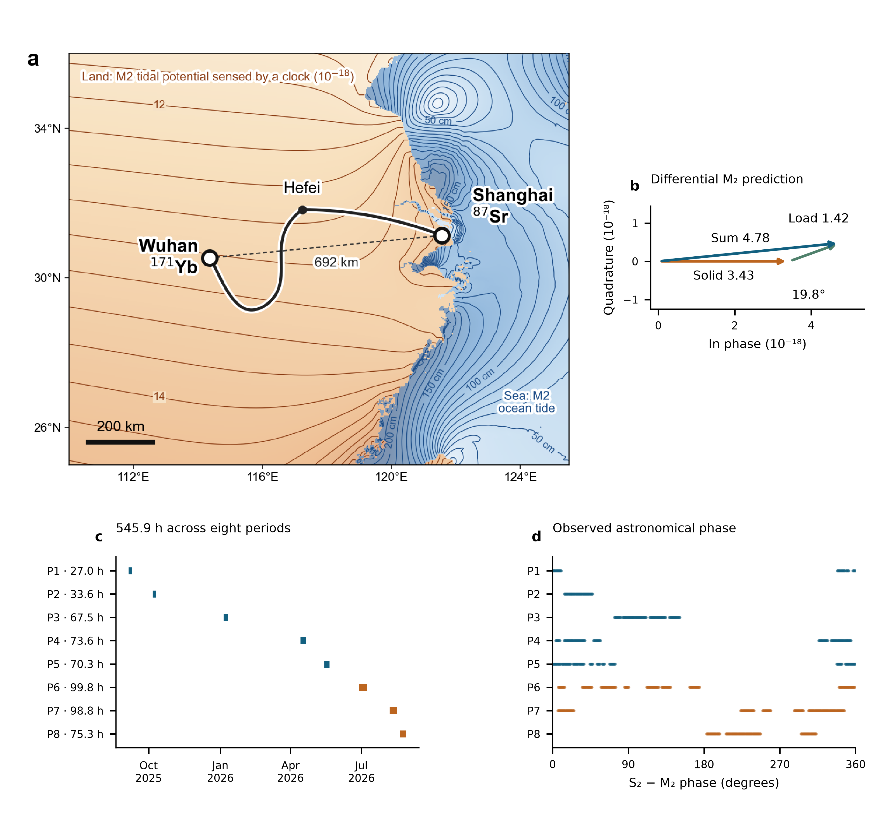

# Tidal potential measured on a coastal–inland optical-clock baseline

## Results

### A coastal–inland baseline for measuring tidal potential

We compared the Shanghai strontium and Wuhan ytterbium clocks using phase-stabilized optical-frequency transfer over a field-deployed fiber network.^19^ The 1,350-km fiber path ran through Hefei and connected sites 692 km apart (Fig. 1a). Evaluations of the Sr and Yb clocks report fractional systematic uncertainties below $1\times10^{-18}$ and $1.3\times10^{-18}$, respectively.^20,21^ The comparison instability is dominated by the two clocks, with a smaller contribution from the fiber link, and follows $5.4\times10^{-16}/\sqrt{\tau/\mathrm{s}}$ for averaging times up to a few days, where $\tau$ is the averaging time.

The coastal–inland geometry gives the two sites different responses to ocean mass redistribution. Shanghai lies close to the East China Sea, whereas Wuhan is inland. As seawater moves, its gravitational attraction changes and its weight deforms the Earth, changing both the local potential and the position of each clock. These effects contribute to the measured potential difference alongside the direct lunar and solar tidal fields and the solid-Earth response. Our prediction combines the IERS solid-Earth tide with ocean loading calculated from FES2022 ocean elevations (Methods).^22,23^

For the principal lunar semidiurnal tide M₂, the solid-Earth and ocean-loading contributions reinforce one another, with a phase difference of 19.8° (Fig. 1b). Their combined predicted fractional-frequency amplitude is $4.78\times10^{-18}$, corresponding to a potential-difference amplitude of about $0.43\,\mathrm{m^2/s^2}$, or 4.4 cm of equivalent height. The ocean-loading amplitude is about 30% of the combined amplitude. These values set the expected signal scale for the comparison; equivalent height expresses a potential difference rather than physical station motion.

The observations extend from September 2025 to August 2026 and comprise 545.9 hours in 54 segments, grouped into eight observing periods over a 353-day span (Fig. 1c). The accepted record contains 3,299 ten-minute means on 43 UTC dates. Summer contributes 273.9 hours, while the earlier periods sample different relative phases of the lunar and solar tides (Fig. 1d). Because the lunar tide shifts relative to the solar day, observations on different dates constrain different combinations of the two signals. We retain the actual observation times and estimate the tidal responses from changes within each segment, allowing each segment its own constant frequency offset. This preserves the astronomical timing across interruptions without requiring a common frequency level between segments.

**Fig. 1 | The coastal–inland clock baseline, tidal prediction and observation window.** **a,** Shanghai Sr and Wuhan Yb connected by the 1,350-km optical-fiber route through Hefei. The dashed line marks the 692-km separation. Land contours show the predicted M₂ fractional clock-rate field in $10^{-18}$; sea contours show ocean-tide height in centimetres. **b,** Differential M₂ phasors for the solid-Earth contribution, ocean loading and their sum. Their amplitudes are 3.43, 1.42 and 4.78 in units of $10^{-18}$, with a 19.8° phase difference between the first two contributions. The solid-Earth phasor defines the phase origin, and both axes have the same scale. **c,** Actual UTC sampling and accepted observation hours in eight periods. **d,** S₂−M₂ astronomical phase at the same observation times, including nodal corrections. P6–P8 are the summer observations. Panels **a** and **b** show predictions; panels **c** and **d** show the observation window.

## References cited in this section

19. Chen, F.-X. et al. $10^{-21}$-Level optical frequency dissemination over 2067 km of noise-loaded field-deployed fiber network. *Light Sci. Appl.* **15**, 276 (2026). <https://doi.org/10.1038/s41377-026-02299-1>
20. Jia, Z.-P. et al. Improved systematic evaluation of a strontium optical clock with uncertainty below $1\times10^{-18}$. *Metrologia* **63**, 025002 (2026). <https://doi.org/10.1088/1681-7575/ae449e>
21. Zhu, Q. et al. Ytterbium lattice clock with systematic uncertainty of $1.3\times10^{-18}$ and instability at the $10^{-19}$ level. *Metrologia* **63**, 065002 (2026). <https://doi.org/10.1088/1681-7575/aeb809>
22. Petit, G. & Luzum, B. (eds) *IERS Conventions (2010)*. IERS Technical Note **36** (2010). <https://iers-conventions.obspm.fr/content/tn36.pdf>
23. CNES. *FES2022 (Finite Element Solution) Tidal model (Version 2024)* [Data set] (2024). <https://doi.org/10.24400/527896/A01-2024.004>
