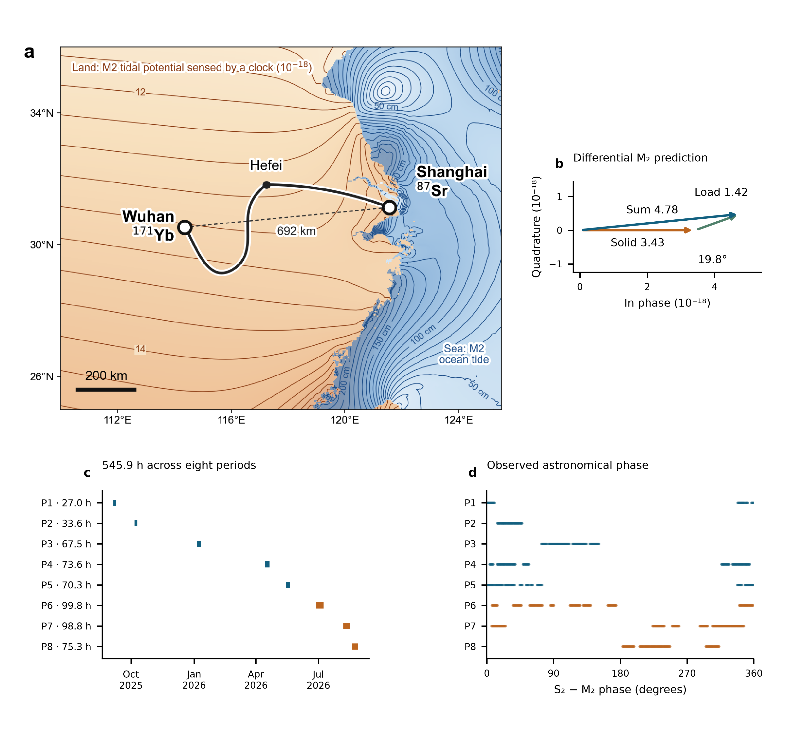
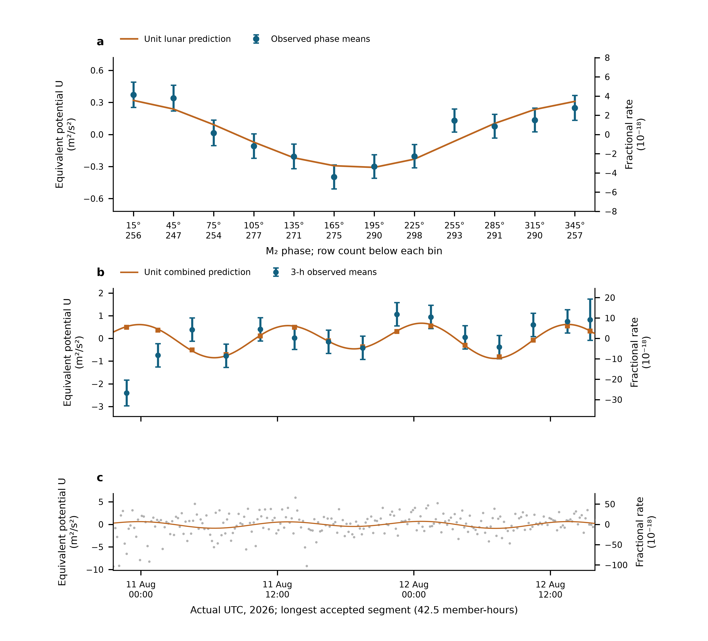
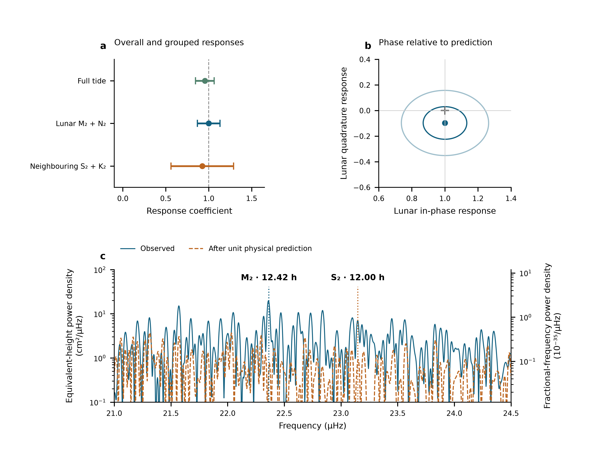
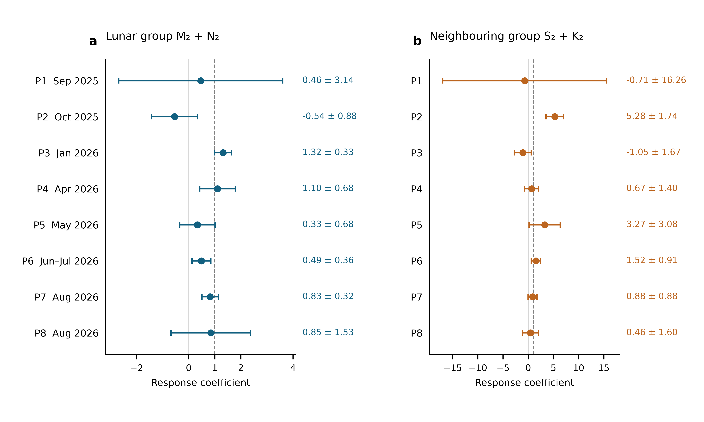
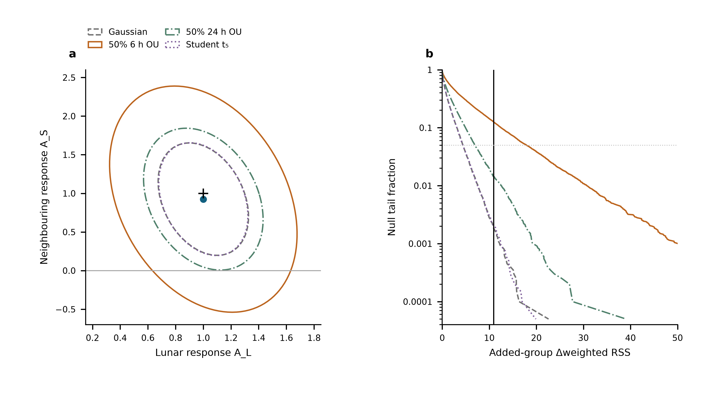
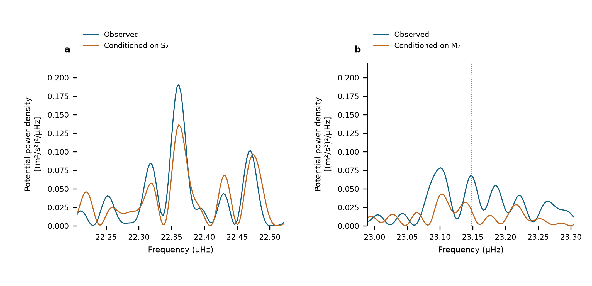
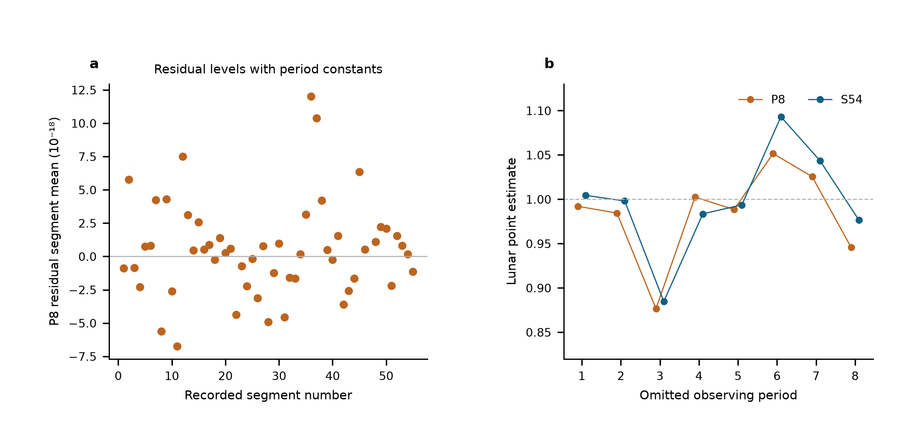
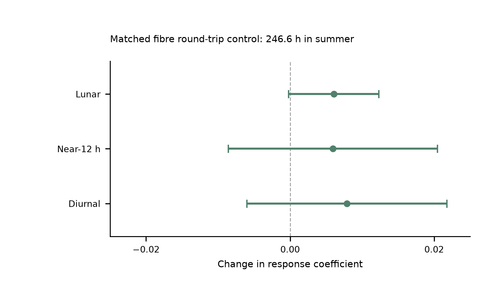

# Tidal potential measured on a coastal–inland optical-clock baseline

::: affiliations
[Author list, order and affiliation assignments to be confirmed by the authors]

^1^ Hefei National Laboratory, University of Science and Technology of China, Hefei, China

^2^ Shanghai Research Center for Quantum Sciences and CAS Center for Excellence in Quantum Information and Quantum Physics, University of Science and Technology of China, Shanghai, China

^3^ Hefei National Research Center for Physical Sciences at the Microscale and School of Physical Sciences, University of Science and Technology of China, Hefei, China

^4^ Innovation Academy for Precision Measurement Science and Technology, Chinese Academy of Sciences, Wuhan, China

^5^ Jinan Institute of Quantum Technology and CAS Center for Excellence in Quantum Information and Quantum Physics, University of Science and Technology of China, Jinan, China

^6^ Time and Frequency Geodesy Center (TFGC), School of Geodesy and Geomatics, Wuhan University, Wuhan, China
:::

**The Moon and the Sun alter Earth’s gravitational potential through their tidal fields and the responses of the solid Earth and oceans. Changes in the tidal potential modify the relative ticking rates of clocks at different locations. Advances in optical clocks and fiber-optic network technologies have made clocks precise probes for probing spacetime, providing an experimental foundation for the long-term vision of monitoring Earth’s gravitational potential with a global clock network. In this work, we use strontium and ytterbium clocks separated by 692 km to detect tidal variations in the potential difference between the coastal region of Shanghai and the inland region of Wuhan. Based on 545.9 hours of observations spanning 353 days, the joint measurement of solid-Earth and ocean loading agrees with model predictions with a consistency of 0.96 ± 0.11. Using spectral analysis, we separated the principal lunar semidiurnal tidal constituent M₂ and the principal solar semidiurnal tidal constituent S₂, with frequencies of 22.361 μHz and 23.147 μHz, respectively, and signal-to-noise ratios of 16.7 dB and 9.3 dB, respectively. This experiment demonstrates that optical clock networks can already be used for high-precision gravitational potential calibration and detection, laying a foundation for related applications.**

## Introduction

Measurements of Earth’s gravity field reveal how water, air, and the solid Earth redistribute mass. Ground-based gravimetry and gradiometry measure gravitational acceleration and its spatial gradients, respectively, while precise leveling combined with gravity observations determines potential differences.^1,2^ Satellite missions have tracked large-scale changes in water storage and the climate system.^3,4^ Monitoring time-varying potential differences between distant stations requires resolving weak signals and distinguishing contributions with similar temporal characteristics.^5^ Tides provide a well-defined test case for this challenge. The tidal fields of the Moon and Sun act together with solid Earth deformation and the redistribution of ocean water. Atmospheric pressure tides also drive the oceans.^6^ The solid Earth tidal potential can reach amplitudes of several $\mathrm{m^2/s^2}$ at individual stations, and resolving smaller contributions requires higher measurement sensitivity.^7^

Optical clocks provide another means of measuring potential differences through their relative clock rates. Near the Earth’s surface, a relative frequency change of $10^{-18}$ corresponds to an equivalent height of about 1 cm.^8^ Experiments have resolved gravitational redshifts on laboratory scales and measured static potential differences between distant sites.^2,9,10,11^ The fractional systematic uncertainty of optical clocks is now approaching $10^{-19}$, and independent lattice-clock experiments have achieved instabilities of a few $10^{-17}/\sqrt{\tau/\mathrm{s}}$, where $\tau$ is the averaging time.^12,13^ Non-tidal mass changes in the atmosphere, oceans, and continental waters may be significant at the $10^{-18}$ fractional frequency level.^7^ Advances in fiber-optic networks and free-space frequency transfer are extending clock comparisons to long distances.^14,15,16,17,18^ These advances are driving the development of optical-clock networks for monitoring time-varying gravitational potentials.^5,8^ However, resolving neighbouring tidal components requires sufficient sensitivity and temporal coverage, especially in the presence of observational gaps.

Here we detect tidal variations in the potential difference between a strontium clock in coastal Shanghai and a ytterbium clock in inland Wuhan. The clocks are separated by 692 km and connected by a 1,350-km fiber-optic link. Using 545.9 hours of observations distributed over 353 days, we combine variations within observing segments while allowing each segment an independent frequency offset. We jointly estimate the responses to two neighbouring semidiurnal tidal groups, M₂+N₂ and S₂+K₂, with phases and relative amplitudes fixed within each group.

## Results

### A coastal–inland baseline for measuring tidal potential

We compared the Shanghai strontium and Wuhan ytterbium clocks using phase-stabilized optical-frequency transfer over a field-deployed fiber network.^19^ The 1,350-km fiber path ran through Hefei and connected sites 692 km apart (Fig. 1a). Evaluations of the Sr and Yb clocks report fractional systematic uncertainties below $1\times10^{-18}$ and $1.3\times10^{-18}$, respectively.^20,21^ The comparison instability is dominated by the two clocks, with a smaller contribution from the fiber link, and follows $5.4\times10^{-16}/\sqrt{\tau/\mathrm{s}}$ for averaging times up to a few days, where $\tau$ is the averaging time.

The coastal–inland geometry gives the two sites different responses to ocean mass redistribution. Shanghai lies close to the East China Sea, whereas Wuhan is inland. As seawater moves, its gravitational attraction changes and its weight deforms the Earth, changing both the local potential and the position of each clock. These effects contribute to the measured potential difference alongside the direct lunar and solar tidal fields and the solid-Earth response. Our prediction combines the IERS solid-Earth tide with ocean loading calculated from FES2022 ocean elevations (Methods).^22,23^

For the principal lunar semidiurnal tide M₂, the solid-Earth and ocean-loading contributions reinforce one another, with a phase difference of 19.8° (Fig. 1b). Their combined predicted fractional-frequency amplitude is $4.78\times10^{-18}$, corresponding to a potential-difference amplitude of about $0.43\,\mathrm{m^2/s^2}$, or 4.4 cm of equivalent height. The ocean-loading amplitude is about 30% of the combined amplitude. These values set the expected signal scale for the comparison; equivalent height expresses a potential difference rather than physical station motion.

The observations extend from September 2025 to August 2026 and comprise 545.9 hours in 54 segments, grouped into eight observing periods over a 353-day span (Fig. 1c). The accepted record contains 3,299 ten-minute means on 43 UTC dates. Summer contributes 273.9 hours, while the earlier periods sample different relative phases of the lunar and solar tides (Fig. 1d). Because the lunar tide shifts relative to the solar day, observations on different dates constrain different combinations of the two signals. We retain the actual observation times and estimate the tidal responses from changes within each segment, allowing each segment its own constant frequency offset. This preserves the astronomical timing across interruptions without requiring a common frequency level between segments.

### Tidal variation in the clock record

The frequency comparison detects the predicted tidal variation in the potential difference between Shanghai and Wuhan. Fitting one amplitude to the complete solid-Earth and ocean-loading waveform gives $A_T=0.96\pm0.11$, where unity represents the prediction. This estimate uses all 3,299 ten-minute means with independent segment offsets. The uncertainty is one statistical standard error, taken as the larger of residual-scaled least squares and deletion of individual UTC observing days. The overall response therefore measures the amplitude of the changing potential across the baseline, while leaving each segment's absolute frequency level free.

The variation is visible when observations from different dates are aligned by lunar phase (Fig. 2a). We remove the fixed minor-constituent remainder and project both the observations and the unit lunar prediction against the segment constants and the other tidal groups. Averaging the resulting values in twelve M₂-phase bins reveals a recurring rise and fall. The error bars include uncertainty propagated through this projection, and the support count is shown for every bin. The amplitude estimate is obtained before phase binning; the display shows how the observed changes accumulate at the predicted astronomical phase.

The same measurement can be viewed on an ordinary time axis. The longest retained observing segment provides a direct time-domain view of the tidal variation (Fig. 2b). It contains 42.5 hours of accepted counter samples and is selected by this observing support. The observations and prediction are centred separately within this segment and averaged in identical three-hour windows. Their variation can be compared directly with the underlying ten-minute observations in Fig. 2c. All 255 means in the segment are retained. Gaps remain gaps, and no empirical daily waveform is removed from this display.

A positive fractional-frequency change means that the Wuhan Yb clock runs faster relative to the Shanghai Sr clock. The left axes in Fig. 2 express this measured rate change as a potential difference, using $U=c^2y=-\Delta W$, while the right axes retain the fractional frequency. The time series and phase plot thus show the physical observable behind the overall response. Both display the record used for the fit.

### Separating semidiurnal responses

The tidal waveform contains nearby astronomical components whose relative phase changes across the observing dates. We estimate their responses in three physical groups, retaining the predicted phases and relative amplitudes within each group. M₂ and N₂ form the lunar semidiurnal group; S₂, the principal solar tide, and the lunisolar constituent K₂ form the neighbouring group. The approximately daily constituents remain as an auxiliary group in the joint model.

The lunar and neighbouring responses are $A_L=1.00\pm0.13$ and $A_S=0.93\pm0.36$, respectively (Fig. 3a), with a scaled least-squares correlation of −0.30. The lunar response provides the more precise component measurement. Both are estimated from the same record as the overall response, using a grouped model that fixes the minor-constituent remainder rather than scaling the entire waveform.

The lunar timing can be tested by allowing a component shifted by a quarter-cycle relative to the prediction. The fitted in-phase and quadrature coefficients are $1.00\pm0.13$ and $-0.10\pm0.20$ (Fig. 3b). The quadrature coefficient measures departure from the predicted phase. Its agreement with zero shows that the observed lunar variation is compatible with the astronomical timing, as well as with the predicted amplitude.

The measured spectrum contains local peaks at 22.361 and 23.147 µHz, near the principal M₂ and S₂ frequencies (Fig. 3c). The astronomical frequencies are separated by about 0.78 µHz; the reported scan maxima are 0.786 µHz apart. The spectrum uses all original observation times, with the missing intervals retained. The logarithmic left axis expresses spectral density in equivalent-height units, with fractional-frequency density on the right. At the two peaks, the observed spectral power divided by the power after subtracting the fixed unit tidal prediction gives 16.7 and 9.3 dB. These before-and-after ratios describe the plotted signal contrast, rather than an independently measured instrumental noise floor.

Interrupted sampling also generates sidelobes. A single injected principal tide produces about 8% of its peak power at the other principal frequency through the actual observation window. Conditional scans, which remove the competing principal sinusoid before examining each neighbourhood, show how this leakage affects the two peaks (Extended Data Fig. 2). Together with the changing phase coverage and the simultaneous group fit, these diagnostics distinguish neighbouring semidiurnal responses. They do not imply that N₂ and K₂ have each been measured separately.

### Consistency across observing periods

The eight observing periods sample different lunar–solar phases and provide individual estimates of both semidiurnal responses (Fig. 4). The intervals show their differing precision; all periods contribute to the common fit through their actual observation times and noise weights. Restricting the analysis to 2026 gives a lunar response of $1.00\pm0.14$ and a full-template response of $0.90\pm0.10$. The separately analysed 2025 record is less precise: its full-template response is $1.37\pm0.53$ (Methods).

The response estimates also survive checks of the solid-tide calculation and correlated errors. Replacing the displacement-derived solid template with a direct-potential calculation and frequency-dependent response gives $A_T=0.94\pm0.11$ and $A_L=1.00\pm0.13$, with the neighbouring coefficient unchanged at the reported precision. Residual-block and time-covariance checks give standard errors close to the reported values (Methods). Segment reference levels remain independent because calibrated zero transfer is not established across all interruptions; the alternative period-level comparison is retained in Extended Data Table 2.

The simultaneous summer fiber round-trip record provides an instrumental control over 246.6 hours. On identical clock and monitor support, including this measurement changes the lunar coefficient by $0.0061\pm0.0063$ and the neighbouring coefficient by $0.00594\pm0.01453$ (Extended Data Fig. 4). These paired changes constrain the monitored transmission path during the overlap; the tidal responses themselves use the full 545.9-hour clock record.

Variation at exactly 12 hours places a stronger boundary on the neighbouring response. Allowing an independently phased 12-hour term in every period gives a full-template response of $0.72\pm0.22$. In the grouped fit, the lunar and neighbouring coefficients become $0.75\pm0.24$ and $-5.10\pm15.01$. This sensitivity test introduces terms that compete with the astronomical templates, particularly S₂, and does not measure the size of an actual laboratory disturbance. The lunar response remains the clearest component, while the neighbouring estimate depends more strongly on the treatment of same-frequency variation. Shared-phase and 24-hour comparisons, together with the uncertainty definitions, are given in Methods and Extended Data Tables 4 and 5.

## Discussion

The comparison detects tidal changes in the gravitational potential difference between two fixed laboratories 692 km apart. The response to the full waveform is consistent with the combined solid-Earth and ocean-loading prediction. Within that signal, the lunar semidiurnal response agrees with the predicted amplitude and phase. The spectrum places the observed variation near the expected principal frequencies, while the joint fit estimates the responses of the two neighbouring semidiurnal groups. Together, these observations demonstrate a dynamic potential measurement through relative clock rates.

Predictable astronomical phase allows this measurement to accumulate across interruptions. Each segment records a changing rate even when its absolute frequency level is unknown. Different observing dates sample different lunar–solar phases, so the segments jointly constrain the physical waveforms without being joined by fitted level shifts. Dividing a record into shorter pieces nevertheless removes more of the slow variation when a separate mean is subtracted. The same-data reference-level comparison shows this effect most clearly for the neighbouring group. The sampling window and segment projection also shape spectral sidelobes; neither effect is equivalent to additional random instrument noise. Longer stable runs and broader astronomical phase coverage can retain more useful signal, although the present periods do not isolate their separate contributions. For an unanticipated transient, sufficient precision would instead have to be reached during the event itself.

The coastal–inland geometry makes ocean loading a substantial part of the tested waveform. Its segment-centred amplitude norm is about one-third of the combined prediction, but its near alignment with the solid contribution at M₂ limits separate estimation from this baseline. A second baseline with a different loading phase or relative amplitude would provide a more distinct geophysical signature. Independent measurements of variations near 12 hours would strengthen attribution of the neighbouring semidiurnal response. These are specific extensions of the demonstrated ability to recover periodic potential changes from distant clocks. An independent European optical-clock network has reported related tidal-potential measurements in a contemporaneous arXiv preprint.^24^

\clearpage

## References

1. Stray, B. et al. Quantum sensing for gravity cartography. *Nature* **602**, 590–594 (2022). <https://doi.org/10.1038/s41586-021-04315-3>
2. Grotti, J. et al. Geodesy and metrology with a transportable optical clock. *Nat. Phys.* **14**, 437–441 (2018). <https://doi.org/10.1038/s41567-017-0042-3>
3. Tapley, B. D., Bettadpur, S., Ries, J. C., Thompson, P. F. & Watkins, M. M. GRACE measurements of mass variability in the Earth system. *Science* **305**, 503–505 (2004). <https://doi.org/10.1126/science.1099192>
4. Rodell, M. et al. Emerging trends in global freshwater availability. *Nature* **557**, 651–659 (2018). <https://doi.org/10.1038/s41586-018-0123-1>
5. Schröder, S., Stellmer, S. & Kusche, J. Potential and scientific requirements of optical clock networks for validating satellite-derived time-variable gravity data. *Geophys. J. Int.* **226**, 764–779 (2021). <https://doi.org/10.1093/gji/ggab132>
6. Arbic, B. K. Atmospheric forcing of the oceanic semidiurnal tide. *Geophys. Res. Lett.* **32**, L02610 (2005). <https://doi.org/10.1029/2004GL021668>
7. Voigt, C., Denker, H. & Timmen, L. Time-variable gravity potential components for optical clock comparisons and the definition of international time scales. *Metrologia* **53**, 1365–1383 (2016). <https://doi.org/10.1088/0026-1394/53/6/1365>
8. Mehlstäubler, T. E., Grosche, G., Lisdat, C., Schmidt, P. O. & Denker, H. Atomic clocks for geodesy. *Rep. Prog. Phys.* **81**, 064401 (2018). <https://doi.org/10.1088/1361-6633/aab409>
9. Chou, C. W., Hume, D. B., Rosenband, T. & Wineland, D. J. Optical clocks and relativity. *Science* **329**, 1630–1633 (2010). <https://doi.org/10.1126/science.1192720>
10. Bothwell, T. et al. Resolving the gravitational redshift across a millimetre-scale atomic sample. *Nature* **602**, 420–424 (2022). <https://doi.org/10.1038/s41586-021-04349-7>
11. Takano, T. et al. Geopotential measurements with synchronously linked optical lattice clocks. *Nat. Photon.* **10**, 662–666 (2016). <https://doi.org/10.1038/nphoton.2016.159>
12. Arnold, K. J. et al. Lu$^+$ optical frequency references with accuracy verified at the 19th digit. *Nature* **658**, 60–64 (2026). <https://doi.org/10.1038/s41586-026-11072-8>
13. Oelker, E. et al. Demonstration of $4.8\times10^{-17}$ stability at 1 s for two independent optical clocks. *Nat. Photon.* **13**, 714–719 (2019). <https://doi.org/10.1038/s41566-019-0493-4>
14. Boulder Atomic Clock Optical Network (BACON) Collaboration. Frequency ratio measurements at 18-digit accuracy using an optical clock network. *Nature* **591**, 564–569 (2021). <https://doi.org/10.1038/s41586-021-03253-4>
15. Lisdat, C. et al. A clock network for geodesy and fundamental science. *Nat. Commun.* **7**, 12443 (2016). <https://doi.org/10.1038/ncomms12443>
16. Lindvall, T. et al. Coordinated international comparisons between optical clocks connected via fiber and satellite links. *Optica* **12**, 843–852 (2025). <https://doi.org/10.1364/OPTICA.561754>
17. Shen, Q. et al. Free-space dissemination of time and frequency with $10^{-19}$ instability over 113 km. *Nature* **610**, 661–666 (2022). <https://doi.org/10.1038/s41586-022-05228-5>
18. Caldwell, E. D. et al. Quantum-limited optical time transfer for future geosynchronous links. *Nature* **618**, 721–726 (2023). <https://doi.org/10.1038/s41586-023-06032-5>
19. Chen, F.-X. et al. $10^{-21}$-Level optical frequency dissemination over 2067 km of noise-loaded field-deployed fiber network. *Light Sci. Appl.* **15**, 276 (2026). <https://doi.org/10.1038/s41377-026-02299-1>
20. Jia, Z.-P. et al. Improved systematic evaluation of a strontium optical clock with uncertainty below $1\times10^{-18}$. *Metrologia* **63**, 025002 (2026). <https://doi.org/10.1088/1681-7575/ae449e>
21. Zhu, Q. et al. Ytterbium lattice clock with systematic uncertainty of $1.3\times10^{-18}$ and instability at the $10^{-19}$ level. *Metrologia* **63**, 065002 (2026). <https://doi.org/10.1088/1681-7575/aeb809>
22. Petit, G. & Luzum, B. (eds) *IERS Conventions (2010)*. IERS Technical Note **36** (2010). <https://iers-conventions.obspm.fr/content/tn36.pdf>
23. CNES. *FES2022 (Finite Element Solution) Tidal model (Version 2024)* [Data set] (2024). <https://doi.org/10.24400/527896/A01-2024.004>
24. Stahl, K. et al. Optical clock network tracks tidal variations of the gravity potential. *arXiv*, 2610.39635v1 (2026). [https://arxiv.org/abs/2610.39635v1](https://arxiv.org/abs/2610.39635v1)

\clearpage

## Figure legends

**Fig. 1 | The coastal–inland clock baseline, tidal prediction and observation window.** **a,** Shanghai Sr and Wuhan Yb connected by the 1,350-km optical-fiber route through Hefei. The dashed line marks the 692-km separation. Land contours show the predicted M₂ fractional clock-rate field in $10^{-18}$; sea contours show ocean-tide height in centimetres. **b,** Differential M₂ phasors for the solid-Earth contribution, ocean loading and their sum. Their amplitudes are 3.43, 1.42 and 4.78 in units of $10^{-18}$, with a 19.8° phase difference between the first two contributions. The solid-Earth phasor defines the phase origin, and both axes have the same scale. **c,** Actual UTC sampling and accepted observation hours in eight periods. **d,** S₂−M₂ astronomical phase at the same observation times, including nodal corrections. P6–P8 are the summer observations. Panels **a** and **b** show predictions; panels **c** and **d** show the observation window.

\clearpage

**Fig. 2 | Tidal variation in the measured clock rates.** **a,** Twelve M₂-phase means of all 3,299 ten-minute observations. The fixed minor remainder is removed, and data and unit lunar prediction undergo identical weighted projection against segment levels and the other physical groups. Error bars are one working standard error with nuisance propagation; means are correlated. Row counts appear beneath the phase labels. **b,** The segment with the largest accepted member count, shown at real UTC. Points are fixed-UTC three-hour means after independent weighted centring of data and prediction. Squares apply the same averaging to the unit combined prediction; the line evaluates it at the observed ten-minute times. Error bars propagate centring. **c,** Every original ten-minute mean in that segment, with its complete vertical range. No empirical daily sinusoid or fit-dependent offset is removed. Left axes use $U=c^2y=-\Delta W$; right axes give fractional rate. Panels are views of the same measurements, and display averaging does not change the primary sample or inference.

\clearpage

**Fig. 3 | Amplitude, phase and frequency of the tidal response.** **a,** The complete-template response and the jointly fitted lunar and neighbouring semidiurnal coefficients. Error bars are one statistical standard error, the larger of scaled least squares and UTC-day-deletion jackknife errors. These are two fits to the same observations, not averaged estimates. **b,** Lunar in-phase and quadrature fit; the cross marks $(1,0)$. Contours use scaled-LS covariance radii one and two, not independently calibrated joint confidence levels. The marginal working errors are 0.13 and 0.20; the scaled-LS quadrature error is 0.127. **c,** The observed 21–24.5 µHz spectrum and the spectrum after subtracting the fixed unit physical prediction. Both vertical axes are logarithmic; the left axis starts at $10^{-1}$ cm²/µHz, and lower values lie outside the displayed range. The scan retains all 3,299 original UTC rows and gaps, with equal weights and 54 segment constants. Markers indicate the prescribed M₂ and S₂ frequencies. Equivalent-height density on the left and fractional-frequency density on the right obey $S_{h,\mathrm{cm}}=10^4c^4S_y/g_0^2$, with $g_0=9.80665\,\mathrm{m/s^2}$. Equivalent height represents potential difference, not station motion. The before-and-after power ratios at the reported peaks are 16.7 and 9.3 dB. Sampling cross-power and conditional scans are given in Extended Data Fig. 2; joint group regions appear in Extended Data Fig. 1. Peaks, phase and amplitudes use the same record and do not add independent detection significance.

\clearpage

**Fig. 4 | Semidiurnal responses in eight individual observing periods.** **a,** Lunar M₂+N₂ coefficients. **b,** Neighbouring S₂+K₂ coefficients. Each point uses only the indicated period, jointly estimates all three physical groups, and retains independent reference levels for its original segments. All eight periods are shown in calendar order, with 163, 203, 409, 447, 429, 601, 595 and 452 ten-minute means, respectively. Error bars show one statistical standard error, the larger of scaled least squares and a UTC-day-deletion jackknife computed within that period. The periods contain 3, 3, 4, 5, 5, 9, 8 and 6 observed UTC dates. Both axes are linear and show the full error ranges; their scales differ. Dashed lines mark the unit prediction. The plotted periods use disjoint observations and are fitted separately; the full-record estimate is obtained by the common physical fit.

\clearpage

## Methods

### Observations, frequency sign and averaging

The Shanghai and Wuhan coordinates used by the prediction are 31.130° N, 121.570° E and 30.529° N, 114.357° E. The measured ratio is Wuhan Yb/Shanghai Sr. With positive geodetic potential $W$, its tidal fractional variation is $-[\delta W_{\mathrm{Wuhan}}-\delta W_{\mathrm{Shanghai}}]/c^2$. The period-relative beat conversion is $-d_p(f_{\mathrm{beat}}-f_{{\mathrm{ref}},p})/F_{1550}$, where $F_{1550}=1.933992\times10^{14}$ Hz and $d_p=2$ in 2025 and 1 in 2026. Thus a 2026 beat deviation of 1 Hz has fractional magnitude $5.17\times10^{-15}$. The 2025 division factor is applied before forming the small clock-rate variation.

The supplied valid-interval table defines 54 segments in 29 operating groups and eight periods. Counter members are read across midnight before binning. Beijing-time labels are converted to UTC. Summer group corrections follow the decimal-arithmetic frequency-chain calculation; early absolute correction entries remain incomplete. Their constant part is represented by segment intercepts, while any time variation within a segment remains a possible systematic contribution. Fitted intercepts are not used to join the runs for long-term stability estimation.

The membership record contains 1,966,908 nominal one-second rows before the minimum-bin-support cut. Three boundary rows reconcile its difference from the printed interval total. Means are formed in nominal 600-s bins separately within each segment and require at least 180 retained members. The 3,299 accepted means contain 1,965,327 members, or 545.924 h. There are 3,291 unique bin centres: eight centres contain separate partial means from different segments, with disjoint members. The 353.39-day span contains observations on 43 UTC dates. The inherited valid mask is retained; this work neither applies an additional triangular filter nor selects points using tidal residuals. Exact raw-file memberships and hashes are retained in the controlled archive.

### What the constituent names mean

Semidiurnal tides produce approximately two cycles per day. M₂ is the principal lunar constituent; N₂ describes an additional lunar variation associated with orbital ellipticity. S₂ is the principal solar semidiurnal constituent, whereas K₂ contains lunar and solar forcing. The names identify astronomical frequencies, not separate instruments or independent experiments. The diurnal group contains K₁ (lunisolar), O₁ (principal lunar), P₁ (principal solar) and Q₁ (lunar elliptic). Their periods are listed in Extended Data Table 1.^25^ Internal relative amplitudes, phases and nodal modulation are fixed within each physical group. A group response therefore tests that complete specified pattern.

### Combined solid and loading potential

The physical target includes the direct astronomical potential, the Earth's induced potential and the effect of clock displacement. The solid sequence used here implements these through the IERS radial displacement $u$ and a fixed effective-potential conversion,

$$y_{\mathrm{solid}}=-\frac{1+k_2-h_2}{h_2}\frac{g(u_{\mathrm{Wuhan}}-u_{\mathrm{Shanghai}})}{c^2},$$

with $h_2=0.6078$, $k_2=0.3010$ and $g=9.794\,\mathrm{m/s^2}$. This approximation applies one conversion to all displacement contributions. We assessed its effect on the estimates by replacing only the solid prediction, retaining the 3,299 observations, timestamps, 54 offsets, original weights and ocean-loading series.

The comparison computes the Moon's and Sun's tide-generating potential directly from geometric DE430 positions, through spherical-harmonic degrees two and three. It uses the stated station coordinates and an ERFA terrestrial rotation. UTC is used in place of UT1 and polar motion is set to zero for this controlled comparison. Two frequency-dependent realizations distinguish the induced potential from displacement: one retains the original displacement and replaces the direct and induced potentials; the other applies frequency-dependent $1+k-h$ to the degree-two forcing. The Love-number response follows the IERS resonance prescription implemented in pyTMD 3.0.9.^22^ A constant degree-three response is retained. The common 90-s template interval is decomposed on the same hourly astronomical basis as the primary calculation; the resulting groups and minor remainder are evaluated at the unchanged bin times. Complex responses are conjugated to match the $\exp(-i\phi)$ convention. This finite-harmonic comparison tests the consequence of the conversion approximation; it is not a separate determination of Love numbers.

The frequency-dependent realization retaining displacement gives $(A_T,A_L,A_S)=(0.9442,1.0028,0.9249)$, with reported errors $(0.1107,0.1318,0.3656)$. The independent frequency-dependent $h,k$ realization gives $(0.9440,1.0019,0.9250)$, with errors $(0.1107,0.1317,0.3657)$. Across these and two constant-response controls, the changes from the primary estimates remain below 0.0141, 0.0036 and 0.0013, respectively. The lunar quadrature coefficient remains between $-0.097$ and $-0.094$, with an error of about 0.20. Although the alternative K₁ solid amplitude is appreciably larger, its effect on the jointly estimated semidiurnal groups is small on this sampling. The loading series is held fixed throughout; these differences therefore quantify the tested solid-template choices rather than a complete physical-model uncertainty budget.

For loading, FES2022 sea-surface elevations $\zeta$ are convolved with the effective-potential kernel

$$\delta W_{\mathrm{load}}=\int \rho_w\zeta(\mathbf{r}',t)G_W(\psi)\,\mathrm{d}A,\qquad
G_W(\psi)=\frac{ga}{M_E}\sum_n(1+k'_n-h'_n)P_n(\cos\psi).$$

The three terms represent direct water attraction, induced potential and clock displacement.^26,27^ PREM load Love numbers are retained through degree 696 with the archived high-degree continuation. Eighteen loading constituents are synthesized with their astronomical nodal corrections. The complex convention is $f\,\mathrm{Re}[C\exp(-i\phi)]$; reversing the exponential sign requires conjugating $C$. The constituent and time-series tables specify this convention throughout the analysis.

The eight named constituents form the three physical groups. Minor terms remain once as a fixed remainder $r_0$. On the actual weighted segment-centred sampling, solid, loading and total root-mean-square variations are respectively 2.928, 1.328 and $4.011\times10^{-18}$. Their ratio 0.331 is an amplitude-norm ratio, not an additive fraction of total power. A separate loading coefficient is not estimated here; the measured group responses test the combined prediction.

### Segment reduction and the two estimands

Let $W_s$ be the original diagonal weight matrix in segment $s$, and define $\langle v\rangle_s=(\mathbf{1}^TW_sv)/(\mathbf{1}^TW_s\mathbf{1})$. For each observation vector and each prediction column we form $\widetilde v_s=v_s-\mathbf{1}\langle v\rangle_s$. This operation uses sample times and weights but no fitted tidal amplitude. For a physical design matrix $T_s$, the common coefficients solve

$$\widehat{\boldsymbol A}=\left(\sum_s\widetilde T_s^TW_s\widetilde T_s\right)^{-1}\sum_s\widetilde T_s^TW_s\widetilde y_s.$$

The segment matrices and vectors contain the information needed for this estimate. All 54 segments enter the same fit; separately fitted segment amplitudes are not averaged. No segment level is transferred to create a continuous, calibrated long-term record.

For the full-response estimate, $y$ is the observed fractional rate before removal of the minor remainder. We fit

$$y_i=c_{s(i)}+A_TT_i+\epsilon_i,\qquad T_i=s_{L,i}+s_{S,i}+s_{D,i}+r_{0,i}.$$

The single coefficient multiplies the complete prediction. The restricted comparison retains only the 54 segment constants. For component estimation, we subtract the fixed minor remainder once and fit

$$y_i-r_{0,i}=c_{s(i)}+A_Ls_{L,i}+A_Ss_{S,i}+A_Ds_{D,i}+\epsilon_i.$$

The full-response model tests the combined waveform, whereas the grouped model allows the three astronomical bands to respond differently. Both use $W_{ii}=1/\sigma_i^2$ with the period-dependent Allan-based uncertainties defined below.

For Fig. 4, we repeat the same three-group estimation separately on each of P1–P8. The data, fixed theoretical remainder and Allan-based weights are inherited from the frozen primary design; each period retains its original segment constants. The UTC-day jackknife is recomputed using only the dates present in that period. The individual-period errors use the same working standard-error rule as the full record.

The daily group is an auxiliary physical component; its coefficient remains $0.58\pm0.54$ (Extended Data Table 2). The interval and correction records do not establish calibrated zero transfer at the 46 boundaries where an eight-period intercept would be shared. They document valid observing times but not signed boundary transfers with uncertainties. The segment convention follows that experimental information.

### Effect of reference-level partitioning

The same observations give slightly different group responses when the reference levels are defined over different intervals. With eight period offsets, the lunar and neighbouring coefficients are $0.987\pm0.123$ and $1.129\pm0.288$; with 54 segment offsets they are $1.000\pm0.132$ and $0.925\pm0.365$ (Extended Data Table 2). Thus the lunar coefficient changes by about +0.013 and the neighbouring coefficient by −0.204. The accepted samples, physical templates and noise weights are identical. What changes is the interval over which a common reference level is assumed. The differences are between correlated estimates, not independent measurements, and the segment model follows the absence of calibrated zero transfer across the relevant interruptions.

The two reductions do not discard different observations: both retain all 3,299 means and their actual times. They differ in the nuisance projection. With reference design $C$ and weights $W$, the retained physical design is $M_CT$, where $M_C=I-C(C^TWC)^{-1}C^TW$. Adding reference-level columns removes additional components from the sampled waveforms and changes the conditional information and correlations. The residual and period-deletion comparisons are shown in Extended Data Fig. 3. This is distinct from interpreting every boundary as a measured physical frequency jump.

The spectrum also projects its trial sine–cosine pairs against 54 segment constants, but uses equal weights, as specified below. Its sidelobes depend on the sampling and projection response. The change between the two weighted amplitude fits cannot therefore be identified quantitatively with the equal-weight spectral leakage without a further comparison; none is asserted here.

### Construction of bin uncertainties

For ten-minute bin $i$, the assigned uncertainty is

$$\sigma_i=\frac{\alpha_{p(i)}}{\sqrt{n_i}},$$

where $n_i$ counts retained nominal one-second members and $\alpha_p$ is the one-second fractional-frequency noise level of period $p$. In this convention the corresponding white-frequency instability is $\alpha_p/\sqrt{\tau/(1\,\mathrm{s})}$. The machine-readable source data provide all eight period coefficients, bin member counts and reconstructed uncertainties.

The noise calculation uses original segments containing at least 8,192 retained members. The fixed unit tidal prediction is evaluated at member timestamps and subtracted after centring within each segment. Overlapping Allan deviations are calculated at 256, 512, 1,024, 2,048 and 4,096 nominal seconds, using the acquisition's one-second member convention. At each averaging time the deviations are averaged across eligible segments, weighted by their member counts. The geometric mean of these averaged deviations multiplied by $\sqrt{\tau/(1\,\mathrm{s})}$ gives $\alpha_p$. No Allan window crosses a segment boundary. These coefficients determine relative fitting weights; residual scaling and day deletion determine the reported statistical errors.

The instability benchmark quoted with Fig. 1a describes the previously reported summer comparison after joining its levels. The present weights are reconstructed from the period coefficients and retained member counts, without using this benchmark. No stability estimate from joined, fit-adjusted levels is used in this analysis.

### Statistical errors and conditional coverage

For each group the reported standard error is the larger of residual-scaled least squares and leave-one-UTC-day-out jackknife errors. Deletions remove a calendar day, refit all remaining coefficients and drop empty intercept columns. The jackknife variance is $(G-1)G^{-1}\sum_g(\hat A_{(-g)}-\overline A)^2$. Period-deletion errors are recorded separately. Extended Data Table 2 gives all components and the same-data intercept comparisons. Observations are repeated measurements of one clock pair, not thousands of independent experiments.

Conditional simulations apply both designs to the same 3,299-row sampling and heteroscedastic uncertainties. Each of four scenarios has 1,000 realizations: independent Gaussian noise; equal variance contributions from Gaussian white noise and a 6-h Ornstein–Uhlenbeck process within segments; the corresponding 24-h process within periods; and standardized Student-$t_5$ noise. The overall scale is the observed segment-model residual scale; all true physical response coefficients are one. Each realization recomputes both components of the standard-error rule. Seed 2026110617 fixes the simulation. Coverage of $\hat A\pm1.96u$ is 95.1–97.4% for the segment-model lunar coefficient and 95.4–96.8% for its neighbouring coefficient; Monte Carlo standard errors are about 0.4–0.7 percentage points (Extended Data Table 3). These tests evaluate errors under the declared noise laws. They do not calibrate the errors against every possible disturbance.

The full-template coefficient uses the same standard-error rule. Its scaled-LS, day-deletion, day-cluster CR1 and period-deletion standard errors are respectively 0.0973, 0.1082, 0.1033 and 0.1216. The CR1 sandwich uses 43 UTC-day clusters and the finite-sample factor $[G/(G-1)][(n-1)/(n-K)]$, with $K=55$. The working interval $\widehat A_T\pm1.96u$ is 0.743–1.167. This working interval does not provide a confidence statement valid for every possible noise process.

For targeted zero-response tests, we compare the weighted RSS of nested models on the unchanged rows. The full-template test adds one entire prediction to segment constants. The neighbouring-group test adds one S₂+K₂ coefficient while retaining the lunar and daily groups and the constants. Noise is generated on the true window with the original heteroscedastic uncertainties and the observed full-model residual scale. Each of the four declared noise scenarios has 20,000 realizations; seeds 2026110711 and 2026110709 fix the full-template and neighbouring-group simulations. The exact residualized-template projection computes the RSS improvement, and direct restricted/full refits check that calculation. The full-template statistic is 110.353; none of the 20,000 draws in any scenario reaches it. The plus-one tail estimate is $1/20,001$ in each scenario, not zero. For the neighbouring statistic 10.943, the corresponding tail estimates are 0.00185, 0.12559, 0.01435 and 0.00205 in the listed noise-scenario order.

Restricted period-wise residual sign flips enumerate all $2^8=256$ patterns, preserving each period's internal structure. The diagnostic tail fractions are 2/256 for the full response and 16/256 for the added neighbouring group. They rely on period independence and symmetry and are not exact experimental randomization tests. The two-sided resolution is 2/256; neither enumeration is converted to a Gaussian sigma value.

The noise scenarios are conditional stress tests, not measured noise laws. In separate 2,000-draw diagnostics per law, the observed within-segment lag-one residual correlation is −0.148. The simulated 95% ranges are −0.054–0.015 for Gaussian noise, 0.216–0.347 for the 6-h mixture, 0.072–0.202 for the 24-h mixture and −0.051–0.017 for $t_5$. Thus the positively correlated mixtures do not describe the observed short-lag structure; neither do the other two laws fully reproduce it. No scenario is selected because of its tidal tail probability. No simulated record is added to the observations.

### Empirical residual dependence and annual checks

We evaluated residual dependence using true 600-s adjacency within original segments, never treating a gap as an elapsed sample. The standardized residual correlations at lags of 600, 1,200 and 1,800 s are $-0.148$, 0.011 and 0.028. Lag-one correlations are negative in all eight periods. These measurements motivate a negative short-lag covariance benchmark without assigning a specific instrumental cause.

The primary WLS coefficients remain fixed for the following uncertainty comparisons. A Bartlett time-kernel sandwich, calculated within each period using actual time differences and bandwidths of 1, 3, 6, 12 and 24 h, gives standard errors of 0.095–0.109 for $A_T$, 0.122–0.130 for $A_L$ and 0.271–0.312 for $A_S$. We also resampled HC2-adjusted standardized residuals in circular moving blocks confined to each uninterrupted 600-s run, restoring the original bin scales afterwards. Requested block lengths of 1, 3, 6 and 12 h give errors of 0.089–0.113, 0.117–0.142 and 0.262–0.299, respectively (2,000 realizations per length; seed 2026110744). Blocks are capped by run length; these resamplings test local dependence and retain the measured residual distribution.

A period-specific MA(1) benchmark sets adjacent covariance and variance from the HC2 residuals and uses Gaussian innovations. On 2,000 simulated records, the two-sided $1.96\max(u_{\mathrm{LS}},u_{\mathrm{day}})$ intervals cover the generating values in 97.7%, 97.8% and 98.3% of cases for $A_T$, $A_L$ and $A_S$ (seed 2026110745). This benchmark reproduces the sign and approximate magnitude of the observed lag-one correlation, but underrepresents the residual tails and slightly misses the third-lag correlation. Its coverage is conditional on that empirical model. The block and covariance checks provide the principal assessment of sensitivity to dependence; no simulation is added to the observations or used to select points.

Separate fits to 2025 and 2026 retain each year's original segments and weights. The 366 means from 2025 give $(A_T,A_L,A_S)=(1.37,-0.18,4.25)$ with working errors $(0.53,0.84,1.97)$; the 2,933 means from 2026 give $(0.90,1.00,0.77)$ with errors $(0.10,0.14,0.35)$. The early record therefore gives a much weaker group separation, while the full-record lunar result is retained in 2026 alone. These are subset estimates, not independent replications of the full record.

Extended Data Fig. 1 gives conditional two-group regions: the first 10,000 draws estimate error covariance and the empirical 95% Mahalanobis threshold; the other 10,000 assess coverage. Held-out joint coverage is 94.3–94.8%, with binomial Monte Carlo standard errors of about 0.22 percentage points and additional calibration uncertainty. These nominal regions apply to the specified laws. They do not replace the reported marginal working errors with a universally calibrated joint confidence region.

The phase-relaxed model adds a lunar component shifted by a quarter-cycle while retaining the prescribed M₂/N₂ relationship. Covariance contours use scaled least squares. Subset and deletion fits refit the same model on their retained rows. Shared-data estimates are not averaged. The simulation coverage refers to two-sided intervals; the reported $\pm$ values are standard errors.

### Phase means, spectral density and sampling sidelobes

For the phase plot, $N$ contains segment constants and the two non-lunar groups. We project both $y-r_0$ and the unit lunar prediction with $M_N=I-N(N^TWN)^{-1}N^TW$, and average in twelve fixed M₂ phase bins. If $B$ is weighted bin averaging, the mean covariance is $BM_NC_yM_N^TB^T$, where $C_y$ is the scaled working observation covariance. This covariance retains correlations between means and propagates uncertainty from nuisance estimation. The response is estimated from the original ten-minute means, before phase binning.

For the actual-time display, the representative segment maximizes accepted nominal member count, with segment ID breaking ties. Segment 51 contains 255 ten-minute means and 153,000 members. Its 42.5 member-hours extend from 10 August 2026 21:35 UTC to 12 August 15:55 UTC. Three-hour display bins follow fixed UTC boundaries and remain inside the segment. All 255 means are assigned; none is removed to improve the display. Weighted averaging is identical for observed and unit-predicted centred values. If a display bin has total weight $w_b$ and its segment has total weight $w_s$, the centred-observation variance is $\widehat\sigma^2(1/w_b-1/w_s)$. This propagates the segment-mean operation and creates correlations between display means. The curve at ten-minute timestamps is a sampled physical prediction, not gap filling. The potential display uses $U=c^2y$ and the right axis retains the fractional rate.

Figure 3c preserves the independently specified equal-weight, 54-intercept scan of the unchanged observed means, rather than replacing it with the amplitude fit's weights. Every trial sine–cosine pair and the data are projected against the same constants. For a reduction in squared residuals $\Delta\mathrm{RSS}(f)$ with dimensionless $y$, the nominal one-sided projection density is $S_y(f)=600\,\mathrm{s}\,\Delta\mathrm{RSS}(f)$ per Hz, or $10^{-6}$ times that value per µHz. Potential density is $S_W=c^4S_y$; amplitude density is $c^2\sqrt{S_y}$. Uniform-grid checks reproduce the conventional one-sided Fourier density. For interrupted data this normalization is a stated projection density, not a Parseval-calibrated variance over a filled year.^28^

For the equivalent-height display, $h_{\mathrm{eq}}=U/g_0$, where $g_0=9.80665\,\mathrm{m/s^2}$ is conventional standard gravity. The density in centimetre-squared units is $S_{h,\mathrm{cm}}=10^4S_W/g_0^2$; this is a representation of potential difference, not station displacement. Both density axes in Fig. 3c use logarithmic scales. The left-axis display starts at $10^{-1}$ cm²/µHz. Values below this limit remain in the source spectrum and are clipped only by the plotting range; no numerical floor is applied. The ratios reported in the summary are $10\log_{10}[P_{\mathrm{observed}}(f)/P_{\mathrm{residual}}(f)]$ at the stored scan points nearest the two reported peak positions. The residual spectrum follows subtraction of the fixed unit physical prediction. The values 16.7 and 9.3 dB therefore compare the before-and-after spectra on the same observation window; they are not ratios to an independently measured instrumental-noise spectrum.

The frequency step is 0.002729 µHz, and the inverse calendar span is 0.032752 µHz. Fine plotting steps do not improve physical resolution. The listed peak positions are scan maxima. No constituent-frequency fit or frequency-confidence interval is reported. M₂-only and S₂-only astronomical injections use the same actual times, nodal factors and equal-weight segment projection. Power at the opposite principal frequency, divided by power at the injected frequency, gives 0.08027 and 0.08149. Conditional scans project out a freely phased sinusoid at the other frequency before scanning the target neighbourhood. Amplitude interference means that such corrections act on sampled waveforms or complex coefficients, not by subtracting scalar power spectra. Gaps alone do not predict the realization of measurement noise. Residual density can describe remaining measurement fluctuations, but includes possible model mismatch and cannot be called a pure instrumental noise floor.

### Instrument and daily-response checks

The matched monitor calculation uses 1,482 rows with 887,882 nominal members, or 246.634 h, in P6–P8. Both baseline and augmented fits have identical members, segment labels and weights. Paired day-deletion replicates propagate uncertainty in their difference. Extended Data Fig. 4 reports the response changes and dates. This comparison concerns the monitored transmission route during the measured overlap.

On the selected data and model, a common 24-h sine–cosine pair gives $A_L=1.036\pm0.133$; separate 24-h pairs in each period give $1.003\pm0.136$. These daily sensitivity designs address a periodicity motivated by temperature and operating schedules, without assigning an independently measured thermal amplitude. A shared 12-h pair gives lunar $0.994\pm0.132$ and neighbouring $2.931\pm1.011$. Separate pairs in each period give $0.751\pm0.242$ and $-5.100\pm15.008$. The normalized design condition number grows from 2.37 to 6.90 and 122.54, respectively; all designs retain full numerical rank. These terms test same-frequency identifiability and are not independently measured disturbances. Extended Data Table 4 reports both groups and their 1.96-SE working intervals.

The full-template sensitivity fits add either one shared 24-h sine–cosine pair or a separate 12-h pair in each of the eight periods. The basis functions are evaluated at the recorded UTC bin centres. All 3,299 observations, 54 segment constants, original weights and the full minor remainder are retained. Each model recomputes scaled least-squares and 43-day-deletion errors; Extended Data Table 5 lists both components. These scalar-response fits are distinct from the grouped models in Extended Data Table 4.

### AI-assisted preparation

OpenAI Codex assisted English drafting, code preparation and checking, numerical replay, controlled template and noise-sensitivity calculations, and plotting from derived experimental tables using Python. The geographical map in Fig. 1a was supplied by the authors and retained unchanged. No observations were generated to replace or fill the experimental record. This revision re-estimated the tidal responses from frozen derived inputs, compared solid-potential realizations and evaluated residual dependence. Original counter selection and corrections were not reconstructed in these checks. [Authors to confirm the tool and version details, their verification of the code, source data, statistics, figures and citations, and responsibility for the final work.]

## Data availability

The author review package contains the 3,299 derived means, fixed templates, noise weights, figure source tables and immutable input hashes. The original counters and membership ledger are held in the controlled experimental archive. [Authors to supply an editor-accessible location and confirm the permanent data-access statement and repository identifier before submission.]

## Code availability

The package contains the independent QR replay, same-data design comparison, conditional simulations, spectral calculations, covariance propagation and figure scripts, with software versions and a reproducible entry point. [Authors to confirm the code licence and permanent repository identifier before submission.]

## Methods references

25. NOAA. Harmonic constituents. *NOAA Tides and Currents*. [https://tidesandcurrents.noaa.gov/harcon.html?id=8577330](https://tidesandcurrents.noaa.gov/harcon.html?id=8577330) (accessed 6 November 2026).
26. Farrell, W. E. Deformation of the Earth by surface loads. *Rev. Geophys.* **10**, 761–797 (1972). [https://doi.org/10.1029/RG010i003p00761](https://doi.org/10.1029/RG010i003p00761)
27. Han, D. & Wahr, J. The viscoelastic relaxation of a realistically stratified earth, and a further analysis of postglacial rebound. *Geophys. J. Int.* **120**, 287–311 (1995). [https://doi.org/10.1111/j.1365-246x.1995.tb01819.x](https://doi.org/10.1111/j.1365-246x.1995.tb01819.x)
28. VanderPlas, J. T. Understanding the Lomb–Scargle periodogram. *Astrophys. J. Suppl. Ser.* **236**, 16 (2018). <https://doi.org/10.3847/1538-4365/aab766>

## Acknowledgements

[To be completed by the authors.]

## Funding statement

[Funding sources and grant identifiers to be completed by the authors.]

## Author contributions

[To be completed and approved by all authors.]

## Competing interests

[Declaration to be supplied by the authors.]

## Additional information

**Correspondence:** [Corresponding author names and email addresses to be supplied; mark them with an asterisk in the author list.]

\clearpage

## Extended Data

**Extended Data Fig. 1 | Conditional uncertainty of the neighbouring response.** **a,** Nominal 95% joint regions for $(A_L,A_S)$ under four declared noise laws on the original 3,299-row design. The point is the observed estimate and the cross is $(1,1)$. Each region uses 10,000 calibration and 10,000 validation simulations; held-out coverage is 94.3–94.8%. The regions are conditional on the specified laws, none of which fully matches the measured short-lag residual structure. **b,** Null tail curves for the added S₂+K₂ coefficient from 20,000 simulations per law. The vertical line marks the observed weighted-RSS improvement; the dotted horizontal line is 0.05. Simulations are separate from the measured data. The declared scenarios provide sensitivity information, not four additional experiments or an independently validated laboratory-noise model.

\clearpage

**Extended Data Fig. 2 | Conditional semidiurnal scans.** Equal-weight scans of the same 3,299 observations with 54 segment intercepts. **a,** M₂ neighbourhood before and after projection of a sine–cosine pair at S₂. **b,** S₂ neighbourhood before and after projection at M₂. Dotted lines show the astronomical target frequencies. These are descriptive projections on shared observations, not additional detection probabilities.

\clearpage

**Extended Data Fig. 3 | Same-data comparison of reference-level designs.** **a,** Weighted segment-mean residuals after the eight-period joint fit, ranging from $-6.75$ to $12.00\times10^{-18}$. Segment constants make these means zero by construction. **b,** Lunar point estimates after period deletion, spanning 0.877–1.052 with eight period constants and 0.885–1.093 with 54 segment constants. The weighted residual sums of squares are 3,781.58 and 3,713.64; the latter has 46 additional intercept parameters. Unweighted residual root-mean-square values are 24.114 and $23.934\times10^{-18}$, and reduced residual sums of squares are 1.1501 and 1.1455. Adjacent standardized residual correlations are −0.127 and −0.148, using pairs within the same segment and separated by at most 900 s. All comparisons retain identical observations, templates, corrections and noise weights. These are residual diagnostics, not measurements of physical jumps or zero-transfer calibration.

\clearpage

**Extended Data Fig. 4 | Simultaneous summer transmission control.** Changes caused by adding the fibre round-trip monitor to the joint model, with paired UTC-day-jackknife standard errors. Baseline and augmented fits use identical clock/monitor members, labels and weights: 1,482 means containing 887,882 nominal one-second members, or 246.634 h in P6–P8, from 29 June to 25 August 2026. The lunar, neighbouring and daily shifts are respectively $0.00606\pm0.00627$, $0.00594\pm0.01453$ and $0.00791\pm0.01388$. The paired monitor constrains the measured transmission route on this summer overlap. The main tidal estimate uses the entire 545.9-h clock record. The prior transmission-architecture demonstration over 2,067 km is a separate experiment.^19^

\clearpage

**Extended Data Table 1 | Astronomical constituent guide.** Names specify forcing and frequency; one response coefficient multiplies each complete group with its internal ratios and phases fixed.

| Symbol   |   Period_h | Meaning                     | Group     |
|:---------|-----------:|:----------------------------|:----------|
| M2       |     12.421 | Principal lunar semidiurnal | Lunar     |
| N2       |     12.658 | Lunar elliptic semidiurnal  | Lunar     |
| S2       |     12     | Principal solar semidiurnal | Near-12 h |
| K2       |     11.967 | Lunisolar semidiurnal       | Near-12 h |
| K1       |     23.934 | Lunisolar diurnal           | Diurnal   |
| O1       |     25.819 | Principal lunar diurnal     | Diurnal   |
| P1       |     24.066 | Principal solar diurnal     | Diurnal   |
| Q1       |     26.868 | Lunar elliptic diurnal      | Diurnal   |

\clearpage

**Extended Data Table 2 | Estimator and uncertainty comparison.** All previously replayed designs use the same 3,299 means, physical templates and Allan-based weights. Errors are standard errors.

| Design   | Lunar         | Near_12h      | Diurnal       | Prior status |
|:---------|:--------------|:--------------|:--------------|:---------|
| S54      | 1.000 ± 0.132 | 0.925 ± 0.365 | 0.579 ± 0.538 | Replayed |
| G29      | 0.984 ± 0.124 | 1.093 ± 0.298 | 0.759 ± 0.420 | Replayed |
| P8       | 0.987 ± 0.123 | 1.129 ± 0.288 | 0.678 ± 0.359 | Replayed |

| Group     |   Estimate |   Scaled_LS |   Day_JK |   Period_JK |   Reported_SE |
|:----------|-----------:|------------:|---------:|------------:|--------------:|
| Lunar     |     1.0004 |      0.132  |   0.1218 |      0.147  |        0.132  |
| Near-12 h |     0.9251 |      0.2993 |   0.3649 |      0.3531 |        0.3649 |
| Diurnal   |     0.5792 |      0.3887 |   0.5381 |      0.7735 |        0.5381 |

\clearpage

**Extended Data Table 3 | Conditional 95% interval coverage.** Each scenario has 1,000 simulated realizations per design, with fixed observed sampling and weights. Values are percentages for the larger-of-LS-and-day-jackknife rule, using multiplier 1.96. They assess the specified scenarios, not unknown systematic effects.

| scenario            | design   |   Diurnal |   Lunar |   Near12h |
|:--------------------|:---------|----------:|--------:|----------:|
| 50% OU 24 h, period | P8       |      97.9 |    98   |      97.3 |
| 50% OU 24 h, period | S54      |      96.4 |    95.1 |      95.4 |
| 50% OU 6 h, segment | P8       |      94.7 |    95.7 |      96   |
| 50% OU 6 h, segment | S54      |      95.8 |    95.6 |      96.3 |
| Student t (df 5)    | P8       |      96.8 |    96.3 |      96.2 |
| Student t (df 5)    | S54      |      96.2 |    96.1 |      96.8 |
| Gaussian            | P8       |      95.7 |    96.2 |      95.9 |
| Gaussian            | S54      |      95.5 |    97.4 |      96.7 |

\clearpage

**Extended Data Table 4 | Same-data 12-h sensitivity.** Each row retains the original 3,299 means, 54 segment levels, astronomical group templates and Allan weights. Errors are the larger of scaled LS and day-deletion jackknife standard errors. Working intervals are estimate ±1.96 standard errors; they are not calibrated for all correlated-noise or deterministic-disturbance models. A common 12-h sine–cosine pair has one phase across the record; the period-wise design gives each of eight periods its own pair. These fits assess degeneracy, not the independently established magnitude of an instrumental effect.

| Model           | Lunar coefficient   | Lunar working interval   | Neighbouring coefficient   | Neighbouring working interval   |
|:----------------|:--------------------|:-------------------------|:---------------------------|:--------------------------------|
| Primary         | 1.000 ± 0.132       | [0.742, 1.259]           | 0.925 ± 0.365              | [0.210, 1.640]                  |
| Shared 12 h     | 0.994 ± 0.132       | [0.735, 1.252]           | 2.931 ± 1.011              | [0.950, 4.913]                  |
| 12 h per period | 0.751 ± 0.242       | [0.277, 1.224]           | -5.100 ± 15.008            | [-34.515, 24.316]               |

\clearpage

**Extended Data Table 5 | Full-template response and sensitivity.** Each fit uses the same 3,299 ten-minute means, 54 segment constants and Allan-based weights. The scalar response multiplies the complete solid-Earth and ocean-loading waveform, including the minor-constituent remainder. Standard errors are statistical; the reported value is the larger of scaled least squares and UTC-day-deletion jackknife. The grouped-model sensitivities remain in Extended Data Table 4.

| Model                           |   Response |   Scaled LS |   Day jackknife |   Reported SE |
|:--------------------------------|-----------:|------------:|----------------:|--------------:|
| Whole template                  |     0.9551 |      0.0973 |          0.1082 |        0.1082 |
| With shared 24-h pair           |     1.0316 |      0.1028 |          0.098  |        0.1028 |
| With period-specific 12-h pairs |     0.7222 |      0.1791 |          0.2212 |        0.2212 |
