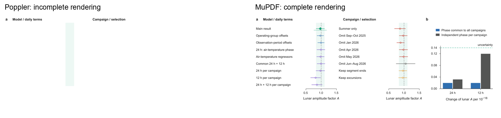

**Nature Article 投稿前核查报告：图表数量、篇幅与文件问题**

核查日期：2026-11-09。对象：当前 v3.22，图4 Option B 覆盖版；本地稿件提交 `756906b`，GitHub 稿件提交 `0881439431f97b88392301ac0f5f11f9ed32e925`。本轮只读检查，未修改论文、图件、作者信息或科学结果。SI 不计入正文篇幅，但其图表归属仍作投稿格式检查。

**结论：主文图表数量与文字篇幅处在 Nature Article 常规初投指导范围内，没有因超长而删主图或压缩正文的必要；当前 PDF 暂不宜直接投稿，首先需要处理图4的渲染兼容性问题。扩展数据编号、ED/SI 分配和作者信息也尚有待处理项。** 这里的“符合数量/篇幅指导”不等于所有投稿要件已经齐备，也不评价编辑是否接收科学主张。

**实际计数与判断**

| 项目 | 当前实测 | Nature 对应指导 | 判断 |
|------------------|-----------------------:|----------------------------------|-----------------------|
| 主图＋主表 | 4 图＋1 表＝5 个展示项 | 典型6印刷页约4项；8印刷页约5–6项 | 数量合理，不是“最多只能4项” |
| Extended Data | 7 图＋3 表＝10项 | 图、表合计通常最多10项 | 达到上限，不能继续直接加项 |
| 摘要 | 188词 | 初投指导约200词、带引用 | 在指导范围内 |
| 正文 | 1,575词；加 Note added 为1,615词 | 典型6页约2,500词；8页约4,300词 | 未超长 |
| 摘要＋正文＋Note added | 1,803词 | 用较宽口径对照上述文字预算 | 仍有余量 |
| Methods | 2,303词 | 通常不超过3,000词，可因需要增加 | 在指导范围内 |
| 主图图注 | 图1 236；图2 134；图3 182；图4 156词 | 初投页面建议每则少于250词 | 四则均满足较严格指导 |
| 参考文献 | 正文29篇，Methods新增6篇，共35篇 | 正文通常最多50篇；Methods另计 | 数量满足 |
| 标题 | 52字符，含空格 | 75字符以内 | 满足 |
| 合并稿文件 | 11.231 MB | 图文合并初稿指导上限30 MB | 文件大小满足 |

篇幅、主文展示项、图注和引用数量依据 [Nature 初投指南](https://www.nature.com/nature/for-authors/initial-submission)；正文/摘要计数口径及文件大小另参考 [Article formatting guide](https://www.nature.com/nature/for-authors/formatting-guide)。ED总数依据 [Extended Data 图件指南](https://research-figure-guide.nature.com/figures/extended-data-formatting-guidelines/)。这些是普通 Article 的典型篇幅与格式指导，不是给每篇初稿规定“必须恰好6或8页”。

引言327词、Results 866词、Discussion 382词、Note added 40词。Table 1全部文字90词另计；把它也加入摘要＋正文仍为1,893词。Methods、图注、参考文献、ED与作者信息不混进正文词数。按本次计数口径的非SI分项文字合计7,434词（含作者信息、图表文字和参考文献；不含标题、节标题及独立陈列公式），这个总数不能拿去直接与2,500/4,300词的正文预算比较。

合并PDF为47页，SI从第34页开始，故**不含SI为33页**；SI为14页。`NATURE_ARTICLE_MAIN_v3.22.pdf`为23页，是文字与图注配套稿，不能把它的页数当作完整图文稿的非SI页数。正文稿的双倍行距、单列排版和整页图表页不等同于期刊印刷页；不能因为33大于8就判定篇幅超限，也不能据现有PDF保证最终印刷页数。

**图表是否值得保留**

| 展示项 | 当前任务 | 本轮建议 |
|------------|----------------------------------------|------------------------------------------------|
| Fig. 1 | 基线、潮汐模型、观测时间及相对相位覆盖 | 保留，提供实验与采样背景 |
| Fig. 2 | 夏季时序及月潮相位折叠 | 保留，直接展示观测随相位的变化 |
| Fig. 3 | 响应、相位与频谱 | 保留，是定量主结果图 |
| Fig. 4 | 稳健性及每日扰动对月潮估计的影响 | 保留 Option B 的结构；先修复PDF导出问题 |
| Table 1 | 分量的信噪比与采样限制 | 保留，与波形/响应图的作用不同 |

当前没有仅凭数量或篇幅撤掉Fig. 4、重排Fig. 3或删掉Table 1的理由。主图首次引用顺序1–4正确；主图与图注在合并稿第10–13页分别同页显示。ED图位于24–30页、ED表位于31–33页。这些是本地实测和编辑判断，不代表期刊已批准版面。

**问题清单——仅供选择执行，本轮一项也未改**

| 编号 | 优先级 | 问题、证据与建议 |
|------|-----------------|-----------------------------------------------------------------------------|
| A01 | 投稿前优先处理 | **新版图4存在PDF兼容性故障。** Poppler实际渲染只显示部分标题和浅绿带，数据点、区间及b面板缺失；MuPDF显示完整。独立图4及合并稿第13页受影响。3处虚线指令缺少phase参数：两处`[2 2] d`及一处`[3 2] d`。这是本次图4导出引入的问题，旧版未出现。建议以后修复导出指令并重新构建，分别用Poppler和MuPDF验证；不涉及重算数据。本轮不修复。 |
| A02 | 投稿前整理 | **ED图首次引用顺序为2、3、4、5、6、7、1。** 正文先引用ED2/3，ED1直到`auxiliary_methods.md`第31行才出现。官方检查表明确要求ED在正文或Methods按编号顺序引用。建议随后统一编号及所有交叉引用，或在真实相关的前文位置先引ED1；不能只改文件名。 |
| A03 | 图表分配需处理 | **ED已满10项，SI另有4图、4表。** 初投指南倾向把普通图和小表放入ED；正式格式指南对SI图件更严格。仅把4张SI图直接转成ED就会变成14项，尚未计SI表。建议在保留4主图＋1主表的基础上，审查ED/SI是否可按主题合并、减少重复，或请编辑确认安排；不应仅改名称来绕过数量限制。SI未计入正文长度，不等于其图表归属无需检查。 |
| A04 | 作者信息待确认 | 通讯作者仍为`[Corresponding author name to be confirmed]`及邮箱占位，作者名单未指定实际通讯标记。正式提交前需由作者确定姓名、邮箱和通讯身份；本轮不推断人选。 |
| A05 | 已知作者决定与投稿要件有差距 | **Author Contributions确已删除。** 当前PDF和活动源文件中均没有该节，符合您的删稿指令；Nature初投指南仍要求逐位作者贡献声明。报告只记录这一缺项，不恢复、不暂拟任何贡献内容。提交时如何完成该声明需由作者决定。 |
| A06 | 可访问性待落实 | Data/Code availability均写向作者合理请求；目前通讯联系人又未确定。需要确认编辑和审稿人实际如何取得支持结果的数据与代码及是否有限制。仅有私有排版仓库不等于完整科研数据已可获取；不能从现有证据认定“初投必须先有Zenodo DOI”，也不应编造仓库或访问承诺。 |
| A07 | 小幅图注完善 | Fig. 4明确说明薄线为95%区间，但普通误差条和阴影带的置信/标准差含义未在该图注中单独写明。Methods已有一标准差说明；为图注可独立理解，建议以后明确普通区间与95%区间的区别。当前结构描述已正确对应左侧两列a和右侧b。 |
| A08 | 图文数值口径核对 | Fig. 1各战役标记60、68、73、70、274 h，整数和为545 h；Methods的filtered validation总时长为544 h。逐项取整可能造成该差异，但本轮未获得精确战役时长来证实。另摘要545.9 h来自主分析，不能据此直接改图。建议仅核对来源/取整说明，不新增计算结果或混用两套口径。 |
| A09 | 终稿制作阶段处理 | 当前独立ED图宽约183 mm，合并稿缩放为166 mm；ED指南的独立文件上限是180×170 mm，且最终文件格式要求与当前PDF工作资产不同。初投合并稿中的显示尺寸可读，但不能把它等同于生产文件逐项合规。随后准备独立ED文件时需按ED专用要求输出并复查字号；不能直接用主图183 mm标准代替ED规则。 |
| A10 | 终稿制作阶段处理 | 两个Methods小标题为42和54字符，超过官方检查表所列40字符。另Greek字符目前采用Arial，官方图件指南指定Symbol；部分原有图仍有背景网格和红绿配色。属于后续制作规范/可读性复核项目，不是本次字数超限，也不应因此声称本研究结果有误。 |

A02、标题长度、小标题长度及作者声明的依据为 [Nature官方检查表](https://www.nature.com/documents/nature-manuscript-checklist-research.pdf)第1–2页。A03的SI归属依据为 [Formatting guide的Supplementary Information部分](https://www.nature.com/nature/for-authors/formatting-guide)；应结合初投的格式弹性判断，不能直接声称有SI图就必然被拒稿。A04–A06依据 [初投指南](https://www.nature.com/nature/for-authors/initial-submission)，本次仅核查声明是否齐备，没有测试科研数据分享。A07及A10图件细节参考 [Nature图件规范](https://research-figure-guide.nature.com/figures/preparing-figures-our-specifications/)；A09依据 [ED专用图件规范](https://research-figure-guide.nature.com/figures/extended-data-formatting-guidelines/)。A01、A08及各项现稿状态来自实际文件检查，具体命令和证据见附件。

A01会影响审稿人能否看到完整图形，优先于文字压缩和美观调整。A02是明确可整理的编号问题。A03需先决定图表归属，不能简单增加ED项；A04–A06需作者提供真实信息或安排。A07–A10分别属于说明、来源核实或制作细节。以上均是建议，不构成已经执行的修改。

**核查方法、证据与边界**

- 计数使用当前`sections/`，去除引用标记和Markdown语法；独立数学运算符不计词，行内公式视为一个对象，陈列公式另记。连字符词和数字使用空白分词，其他软件可能略有差异。主文共有1个陈列公式，Methods共有7个；这些不被虚增为TeX命令词数。
- 实际运行`count_length.py`及独立图表检查；PDF检查同时采用Poppler与PyMuPDF，未只依赖上一轮MuPDF视觉通过记录。原始实验数据未读取或重算；实验单位、重复类型、统计检验、样本量和效应估计不属于这次排版核查的新结果。
- 官方HTML直接访问遇到Nature身份验证重定向，正文规则来自本次检索返回的Nature官方页面索引；官方四页检查表PDF与ED图件指南已直接读取。初投页、正式格式页和制作检查表有阶段差异：本稿图注同时满足较严格的初投250词指导，不必用其他页面的300词阈值放宽；188词摘要也同时低于200词常规目标与检查表230词上限。
- 本轮不重新评判S₂归因、海洋负荷检测或误差预算，也不把此前外部审稿意见自动变成改稿指令。未验证全部参考文献原文、所有作者同意、数据共享权限及投稿系统字段。
- 计数、脚本、逐项图表审核、PDF兼容性证据和本轮前后哈希记录均随报告交付。所有建议保持未执行。

复核入口：`python count_length.py --source <稿件目录>/sections --build <稿件目录>/formal_build_01 --out <新的计数目录>`。本机使用Python 3.12.3；PDF工具版本及诊断命令见`PDF_DIAGNOSTIC.md`。主稿未改验证见`MANUSCRIPT_UNCHANGED.json`。

**A01 实际渲染对照**

下图是同一当前图4 PDF 在两种引擎中的实际输出。左侧缺图是文件语法兼容性问题，不是结果被删除；本轮没有修改该PDF。

{width=100%}
