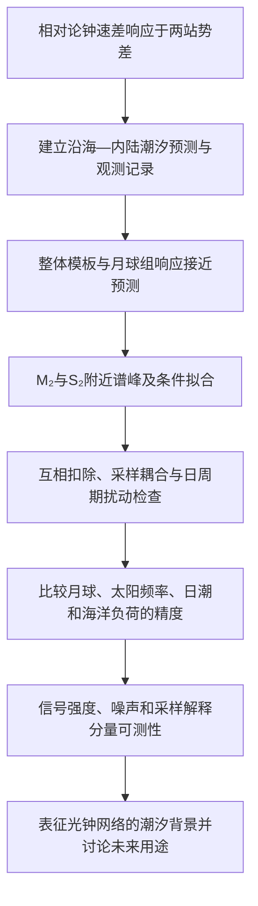

# v3.19 论文主线、逻辑与结构梳理

**性质：现稿说明；独立完成的第一步，不含修改建议。**

对象为 *Tidal potential measured with distant optical clocks*，v3.19 完整阅读版，46 页。[固定版本 PDF](https://github.com/hjiang555-a11y/grav-ws/blob/4c1e30239b98c65d104a698c51ea30e7af7b62d8/reviews/FORMAL_v3.19_20261108T223503Z/NATURE_ARTICLE_v3.19.pdf)。下文页码均指该完整 PDF，不指另行拆分的主文或 SI。数值是对现稿的摘录，本轮未重新计算实验结果。

## 论文围绕什么问题展开

论文研究上海锶光钟与武汉镱光钟之间随时间变化的潮汐势差。两站相距 692 km，由 1,350 km 光纤链路连接。月球和太阳引起的直接引潮势、固体地球形变以及海洋负荷共同改变两地钟速差，因此光钟频率比较可以观测这一动态引力信号。

论文的问题进一步落在**潮汐各成分能被测量和区分到什么程度，以及它们的测量精度为何不同**。M₂ 与 S₂ 频率相近，实际观测存在间断，各段需要拟合偏置，实验室变化又可能带有太阳日及半日周期。这些条件共同决定了两个相邻信号能否在同一组记录中分辨。

现稿的整体论证可概括为：

> 利用跨近一年的沿海—内陆光钟比较记录测量潮汐势差，以模板响应、自由相位频谱及条件拟合说明月球半日潮与太阳频率半日潮成分的可区分性，通过扰动和采样检查确定结果的适用条件，再用信号强度、噪声与实际采样解释不同分量的精度。

这里的“太阳频率半日潮”对应稿件对 S₂ 频率附近成分的表述；稿件还使用带天文相位约束的 S₂/K₂ 组响应，两者有不同的估计方式。

## 从研究问题到结论的论证顺序

**物理起点。** Introduction 从势差引起的相对频移出发，介绍光钟与传递网络的能力，再转入动态地球物理信号以及潮汐成分重叠的问题。末段明确本文的基线、观测规模和三个工作内容：测量、分离、精度解释。（p.2）

**观测基础。** Results 先交代两地光钟、光纤链路和潮汐模型，并以 M₂ 相量说明固体潮与海洋负荷的合成。五次 campaign 的历时及相对相位覆盖说明本组间断记录含有何种辨识信息。（p.3；Fig.1）

**信号测量。** 模板幅度响应、相位结果和夏季时间域显示建立测量与天文预测的对应关系。响应系数 1 表示与对应预测模板的幅度相符。（pp.3–4；Figs.2–3；Extended Data Figs.1–3）

**成分分离。** 稿件随后报告 M₂ 和 S₂ 附近的谱峰，以及控制另一频率和 N₂/K₂ 后的条件谱。自由相位联合拟合提供不固定 M₂/S₂ 相对天文相位的幅度估计。（p.4；Fig.3c；Extended Data Fig.4）

**可靠性和适用条件。** 互相扣除、设计矩阵相关性及旁瓣响应描述采样引起的耦合；实验室日周期、筛选方式、温度、链路监测和分期预测检查描述月球估计对具体扰动与分析选择的敏感性。（pp.4–5；Fig.4；Extended Data Figs.5–7；SM4、SM7）

**精度解释。** 日潮和海洋负荷的单独响应约束较弱，形成 Discussion 的出发点。讨论将不同分量的幅度信噪比与信号强度、时钟噪声、有效观测时间及采样效率联系起来，解释月球分量与弱约束分量之间的差异。（pp.5–7；Table 1；Methods pp.20–21）

## 三组核心结果各自承担的作用

| 结果层次 | 现稿给出的主要量 | 在论证中的作用 | 位置 |
|---|---|---|---|
| 潮汐整体及月球组响应 | 辅助处理的合成模板响应 0.96 ± 0.11；月球组响应 1.00 ± 0.13 | 量化观测与预测的相符程度 | 摘要 p.1；pp.3–4；Fig.3a |
| 相邻半日潮的频率结构 | 22.361、23.148 μHz 处谱峰为 4.87、2.87 cm 等效高度；自由相位联合拟合为 4.13、1.76 cm | 给出频率位置、物理量级和同时控制邻近分量后的幅度 | p.4；Fig.3c；Extended Data Fig.4；Supplementary Table 1 |
| 分量精度的来源 | Table 1 的白噪声/经验 SNR：M₂ 7.17/7.02，S₂ 2.78/1.96，日潮组 1.55/1.08，海洋负荷 1.17/0.89 | 对应信号强度、噪声与采样造成的精度差异 | p.6；Methods pp.20–21 |

谱峰幅度、自由相位联合拟合幅度、预测相位组响应分别属于不同估计问题。谱扫描逐个试验频率，联合拟合同时包含多个正弦分量，组响应则固定组内的相对幅度与天文相位。稿件用它们从不同角度描述同一观测记录；这些结果不构成相互独立的数据集。

Fig.4 的扰动灵敏度围绕月球响应展开。幅度为 10⁻¹⁸、跨 campaign 相位固定的 24 h 或 12 h 扰动，使主处理的月球响应最多变化 0.020；相位可逐 campaign 独立时，24 h 和 12 h 的界分别为 0.032 与 0.12。辅助处理有对应的 0.023、0.030 与 0.12。这些数值界定的是指定扰动模型下的估计变化。（p.5）

## 当前章节怎样分工

| 章节 | 当前内容 | 对全文的作用及衔接 |
|---|---|---|
| Abstract，p.1 | 动态势差背景、测量与分离困难、整体与月球响应、频谱量级、SNR 解释、应用方向 | 将研究对象、主要观测与解释连成一个摘要 |
| Introduction，p.2 | 光钟测势能力；信号重叠与采样缺口；本文观测和分析目标 | 从可测量的物理效应转向成分辨识问题 |
| A coastal–inland clock baseline，p.3 | 基线、光纤、合成潮汐预测、五次 campaign 和两套处理 | 给出后续响应和频谱的共同实验基础 |
| Amplitude, phase and coverage，pp.3–4 | 主/辅助处理的组响应、自由相位检验、夏季相对相位覆盖 | 建立月球半日潮与预测的幅相对应关系 |
| Separate semidiurnal detections，p.4 | 谱峰、预测扣除、条件谱、联合正弦拟合 | 回答两个相邻频率的成分如何被区分 |
| Reliability of the separated signals，pp.4–5 | 互扣、相关性、旁瓣、日周期扰动、环境与筛选检查 | 给出分离和月球响应可靠性的具体证据 |
| Ocean loading and diurnal response，p.5 | 海洋负荷与日潮的较弱独立约束 | 把讨论从“已测到什么”引向“为何精度不同” |
| Discussion，pp.5–7 | 连续段与时间跨度、SNR 标度、Table 1、已有绝对频率比较的关系、未来网络用途 | 解释不同分量的可测性，区分当前结果与后续应用 |
| Note added，p.7 | 欧洲光钟网络的相关潮汐工作 | 将本文定位于沿海—内陆基线上半日潮分量分离的互补研究 |
| Methods，pp.14–21 | 仪器、筛选、潮汐模型、各估计器、误差、扰动和谱分析、SNR | 定义正文每类结果如何产生 |
| Extended Data，pp.23–32 | 主处理响应、分期结果、全记录、条件谱、补偿、相关性、环境检查与模拟 | 支撑正文中简述的实验证据与诊断 |
| Supplementary Information，pp.33–46 | SM1–SM7、四张补充表、四张补充图 | 保存物理模型、估计器差别、校准与诊断的细节 |

## 四幅主图与主表的证据关系

- **Fig.1（p.10）给出预测与采样条件。** a 为地理基线和潮汐势分布；b 为观测日历；c 为 M₂ 固体潮、负荷和合成相量；d 为 S₂−M₂ 相对相位覆盖。它连接空间上的势差与时间上的辨识条件。
- **Fig.2（p.11）展示月球信号的时间域形态。** 去掉拟合偏置和非月球组后的夏季记录与模型比较，并按月球相位折叠。图注保留了被扣除项固定时的误差定义。
- **Fig.3（p.12）集中展示定量结果。** a 为完整模板和分组响应，b 为月球组幅相，c 为幅度谱及扣除固定预测后的谱。摘要中的主要数值主要对应这幅图。
- **Fig.4（p.13）检验月球估计的稳定性。** a 比较估计器及扰动模型的变化，b 量化指定日周期扰动对月球响应的最坏相位影响。
- **Table 1（p.6）将观测结果连接到精度解释。** 它在固定的估计器和实际采样下比较白噪声计算与经验 SNR。相关模板响应的展开结果在 Supplementary Table 2（p.40）。

主文的条件谱与互扣论述分别依赖 Extended Data Figs.4–6（pp.26–28）。Supplementary Fig.2（p.44）进一步展示旁瓣对补偿的响应。因此成分分离的完整证据由主图和扩展图共同承载。

## 两套处理在现稿中的位置

| 项目 | Primary reduction | Auxiliary reduction |
|---|---|---|
| 数据关系 | 同一组光钟比较观测 | 同一组观测，采用另一有效区间选择 |
| 总量与处理 | 544 h；剔除瞬态后，1,200 s 三角窗、600 s 步进 | 545.9 h；3,299 个非重叠 600 s 均值；不做三角滤波或该瞬态筛选 |
| 主要用途 | 时间域显示、主处理组响应、稳健性和注入检查 | 摘要汇总响应、Fig.3、自由相位谱分析、Table 1 |
| 合成模板 / 月球组 | 0.90 ± 0.12 / 0.97 ± 0.14 | 0.96 ± 0.11 / 1.00 ± 0.13 |
| 近 12 h 组 | 0.90 ± 0.29 | 约 0.93 ± 0.36 |
| 单独负荷响应 | 0.89 ± 0.55 | 约 0.49 ± 0.54 |
| 日潮示例 | 两频带拟合为 0.36 ± 0.50 | 三组拟合为 0.579 ± 0.538 |

两套处理共享 54 个观测段，模型实现、权重与误差计算也有区别。Supplementary Table 4（p.42）逐项列出差别；SM4、SM6 和 Supplementary Table 2 说明负荷与日潮数字所属的估计器。

观测结构包含五次 campaign、八个用于留出预测的 observation period、29 个用于 group bootstrap 的 operating group 和 54 个承担偏置参数的 segment。43 个实际有观测的 UTC 日期用于辅助处理的逐日删除协方差。它们承担不同分析任务，不能彼此替代为“独立重复次数”。本研究属于时间序列频率比较，生物学重复分类不适用。（Methods pp.14–21）

## 讨论部分的物理解释与结论范围

Discussion 区分了三个时间量：有效观测时间决定累计信息，连续段长度影响周期覆盖以及信号与段偏置的可区分程度，总跨度影响邻近频率的分辨。缺测和模板耦合通过采样效率进入精度计算。

公式（1）写出局部标度关系，白频率噪声和相干信号对应固定采样效率下的平方根时间增长。Methods 公式（2）将噪声通过实际线性估计器传播，公式（3）把信号强度、噪声和采样效率连在一起。Table 1 显示月球项的经验精度接近相应白噪声计算，太阳频率项的经验误差较大；日潮和单独负荷的 SNR 接近 1。

海洋负荷既进入合成潮汐预测，也作为可独立拟合的模板接受检验；日潮具有较长周期，段偏置会吸收其中部分变化。现稿据此讨论较弱约束的来源，并将延长连续观测、改善时钟稳定度和增加站点作为后续方向。

摘要末句将潮汐背景表征与秒的重新定义、高程系统统一联系起来，文献 8、9 支持这两个应用背景。Discussion 另提到大地测量、暗物质搜索和未来引力波探测。它们在现稿中属于潜在用途，未作为本次实验已经实现的终点。

## 本次梳理的材料与可追溯性

本报告依据固定 PDF、其对应 Markdown 分节、图注、Methods 与 SI 完成；既有研究方案仅用于理解任务范围，没有把旧版梳理报告作为当前论文的替代。未进行原始数据清洗、拟合、统计检验或全面文献查新。所有实验数值均标注为稿件报告值。

论文及源文件输入哈希保存在同批工作目录 `evidence/INPUT_HASHES_BEFORE.json`，PDF 分页文本保存在 `evidence/PDF_PAGES.txt`。文本提取使用 Python 3.12.3 与 PyMuPDF 2.1。此步骤仅涉及文档读取，不需要统计随机种子。

第一步在第二步审阅开始前记录 SHA256 并冻结。后续修改意见另存为独立文件，不回写本说明，也不修改论文。
